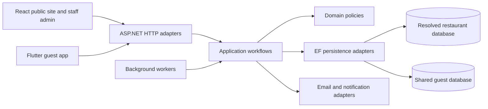

# SeatMap architecture

Updated 26 November 2026. This is a map of the implemented system and its
incremental refactoring boundaries, not a claim that every legacy class is already
Clean Architecture. See [contribution rules](../CONTRIBUTING.md) and the detailed
[server](../backend/ARCHITECTURE.md), [mobile](../mobile/ARCHITECTURE.md) and
[web](../frontend/ARCHITECTURE.md) guides.

## Shape of the system

SeatMap is a modular monolith with a React web client and Flutter guest client.
One ASP.NET Core host serves multiple restaurants. Each restaurant has its own
operational database; shared guest identities live in a separate platform database.
This deployment shape is independent of the code layers: a bounded context does
not need a microservice, a separate database or an interface for every class.

The diagram shows responsibilities. Much legacy persistence and orchestration still
resides inside `SeatMap.Api`; it has not all moved into separate Application and
Infrastructure projects. `SeatMap.Domain` is the extracted dependency-free core.
Do not disguise remaining coupling by renaming folders.

## Business contexts and ownership

| Context | Owns | Collaborates with |
| --- | --- | --- |
| Guest identity | Verified account, sessions, profile, language | Restaurant workflows receive the authenticated guest; they do not implement passwords |
| Restaurant tenancy | Tenant resolution, connection selection, branding, hours, timezone | Every restaurant workflow and background scope |
| Seating and reservations | Floor plan, configured combinations, capacity, availability, reservation lifecycle | Waitlist uses the same conflict/booking rules |
| Waitlist | Request, queue position, exclusive offer, expiry, acceptance | Reservation creation owns the final booking; notification is delivery after allocation |
| Menu and sommelier | Actual menu items, wine inventory and pairing rules | Preorders reference restaurant menu; recommendations cannot invent stock |
| Preorders and dining orders | Guest drafts, line notes, revisions, kitchen/bar and payment workflow | Reservations identify the visit; inventory handles consumption |
| Inventory | Ingredients, recipes, movements and consumption | Dining-order completion triggers existing stock workflow |
| Staff operations | Roles, audit, maintenance, reporting and marketing | Uses restaurant scope and preserves authorization on every write |

These are ownership boundaries, not eight newly isolated projects. Feature-specific
rules should remain in their owning module; do not grow a miscellaneous `Utils`
folder or a universal service that knows all contexts.

## Dependency rules

- **Domain** expresses deterministic rules using supplied values. It does not
  depend on controllers, EF, Flutter widgets, React, HTTP clients or storage.
- **Application** coordinates a business operation. It owns sequencing, scope,
  authorization inputs, transaction boundaries and idempotency decisions.
- **Adapters** translate transport/persistence details into the operation's inputs
  and outputs. JSON mapping belongs here, not in a view or a policy.
- **Presentation** renders state and dispatches actions. UI validation improves
  feedback; it cannot replace server enforcement.
- **Composition roots** wire implementations: server `Program.cs`, mobile app
  initialization, and web feature composition. Do not resolve services globally
  from domain objects.

Use dependency inversion for an actual boundary, not to add pass-through classes.
Existing EF Core contexts already provide change tracking and unit-of-work
behavior; a generic repository wrapper would not automatically improve isolation.
CQRS here means distinguishing commands from queries when useful, not requiring
MediatR or separate read databases. Event sourcing and microservices are not part
of this refactor.

`python3 scripts/check-architecture.py` guards imports in the extracted domain
areas. This is a source dependency check, not a proof of architectural correctness.
It also checks static local web imports for cycles. It deliberately excludes web
test fixtures and documents the existing Flutter geometry dependency on `dart:ui`.
Other legacy areas remain review-enforced.

## Invariants that must survive refactoring

### Tenant and identity boundaries

Resolve one tenant before constructing its operational context. Background work
creates a fresh scope per restaurant. A global guest inbox aggregates authorized
reads across scopes; it must not reuse a tenant context or expose another guest's
rows. Platform identity and staff authorization are separate concepts.

### Booking consistency

A map preview can become stale. The final write rechecks capacity, configured
combinations, closures, public holds and existing reservations under the restaurant
write lock. Waitlist offers take part in that same lock/conflict model. Preserve
this transaction across extraction; moving each check into a separately committed
service would introduce races.

A waitlist request progresses through waiting/offered/paused and terminal states.
An accepted offer creates a reservation exactly once. Decline or expiry pauses the
request; an explicit resume returns it to the back of the queue. Recovery of a lost
confirmation response returns the same booking and rotates its guest capability.
The allocator polls; a newly free table is publicly bookable until an offer is
actually allocated. This is not a strict priority guarantee over direct bookings.

### Time and effects

Restaurant dates and wall-clock times use the configured restaurant timezone;
expiration timestamps use UTC. Pass time into pure policies and use an injected
clock in orchestrators when supported. Never infer restaurant time from a browser's
or server's local timezone.

Persist the outcome before external delivery. Waitlist mail uses a persisted lease
and provider idempotency key; provider failure does not roll back allocation.
System iOS push is not enabled for the current personal-team provisioning profile.
An in-app banner or an email attempt must not be described as delivered APNs push.

### Client state and compatibility

Keep network DTO conversion in data modules. Preserve account ownership checks
across asynchronous responses. Storage and API field names are compatibility
contracts even if internal names become clearer. Generated localization, EF
migrations and persisted snapshots need their own generation/migration workflow;
formatting them as part of a cleanup creates unnecessary risk.

## What this refactor does and does not establish

The accompanying layer guides describe the specific extractions, public entry
points and verification commands. Business behavior, database schema and public
routes are intended to remain unchanged. Review the diff and behavior tests before
publishing; this architectural work does not itself require a production migration.

Remaining large modules include the staff admin composition page, several mobile
screens and legacy dining/inventory/reservation HTTP controllers. Continue by
extracting a complete operation with its input, rule, transaction and tests, then
switch callers. Do not declare a whole bounded context migrated after extracting
one helper. A useful next order is staff reservation commands, dining-order
completion and inventory consumption, then the corresponding admin panels.

## Further reading

- [Server structure](../backend/ARCHITECTURE.md)
- [Mobile structure](../mobile/ARCHITECTURE.md)
- [Web structure](../frontend/ARCHITECTURE.md)
- [Tenant routing](multi-tenancy.md)
- [Shared booking workflow](shared-booking.md)
- [Waitlist behavior and operational limitations](waitlist.md)
- [Preorders and revisions](preorders-and-mobile-menu.md)
- [Platform rollout](seatmap-platform.md)

Earlier dated audits in `docs/` remain historical records, not the source of truth
for current module placement.

## Refactor verification — 26 November 2026

This change was reviewed in separate backend, mobile and frontend workstreams.
It is isolated on `refactor/architecture-2026-11-26`; it is not a production release.

| Area | Evidence |
| --- | --- |
| Domain dependencies | 30 source files pass the boundary guard; deliberate forbidden-import and cycle probes are rejected |
| Web module graph | 129 modules checked, no static local import cycles |
| Server | Solution build succeeded; 9 independent domain and 52 waitlist checks pass; reservation, tenancy, guest, platform and sommelier regression suites pass |
| Flutter | Final complete run: 87 passed, 8 existing skips; analyzer reports no issues |
| React | 154 domain/contract and 38 Cofein checks pass; changed-source ESLint and all three Vite builds pass |
| Browser | Actual Chromium exercises waitlist interactions with fixture HTTP and initializes the extracted admin modules without runtime errors |

The 65 declarations extracted from `AdminPage` retain their prior syntax trees
apart from comments/locations. The page shrank from 12,936 to 7,281 lines; that is
meaningful separation, not completion of all remaining dashboard orchestration.
The former 2,082-line mobile menu module now provides compatibility exports for
separate browsing, cart and orders screens.

Existing web bundle-size warnings remain. These tests do not exercise every
operational admin interaction, real provider delivery or a physical phone. No
schema migration or live guest data change forms part of this refactor.
