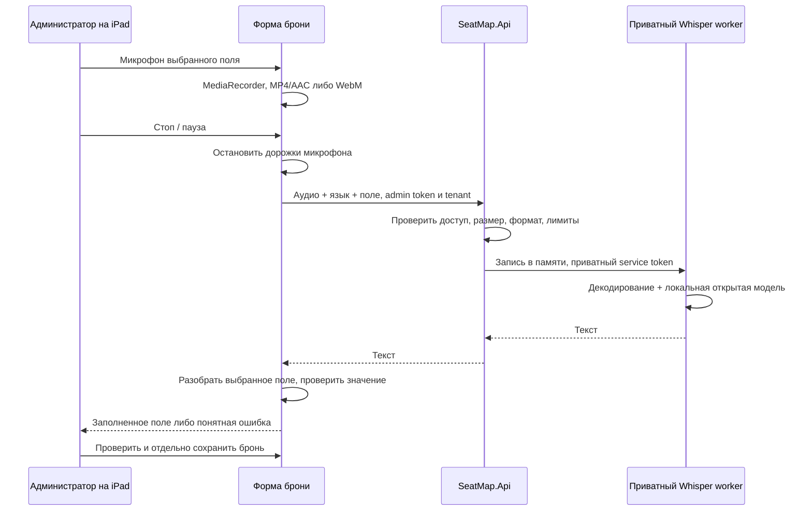

# Голосовой ввод брони: собственный сервис

Состояние на 17 ноября 2026: локальная реализация и проверки. В production
функция не включена. Целевое устройство — iPad с Chrome, основной язык — болгарский.

## Как работает ввод

Администратор нажимает микрофон рядом с одним из шести полей: имя, телефон, дата,
время, гости, email. Запись начинается только после разрешения микрофона. Повторное
нажатие завершает фразу; при работающем анализаторе звука запись также заканчивается
после паузы. Максимум записи — 20 секунд. Состояния ожидания разрешения, записи и
распознавания показаны отдельно.

Голос не сохраняет бронь автоматически. Заполняется только выбранное поле; смена
даты может обновить список допустимого времени. Ручное редактирование, переключение
микрофона, закрытие формы, отправка формы или уход со страницы отменяют текущую
диктовку. Запоздавший ответ не перезаписывает значения. Неоднозначные фразы,
неполные телефоны, недоступное время и прошлые даты новой брони отклоняются.

Болгарские правила поддерживают разговорные обозначения полей, числа словами,
даты с днём недели/месяцем, часы с половиной/четвертью, явные исправления и точный
повтор значения. Адреса электронной почты не получают угаданную транслитерацию.
Имя и контакт администратор всегда проверяет перед сохранением.

## Почему отдельный сервис

Наличие SpeechRecognition в браузере не гарантирует поддержку болгарского:
[WebKit использует Siri speech engine](https://webkit.org/blog/11648/new-webkit-features-in-safari-14-1/),
а болгарский отсутствует в опубликованном [списке Apple Dictation](https://www.apple.com/ios/feature-availability/#dictation).
Поэтому production использует запись через MediaRecorder и наш worker. Старый
WebSpeech оставлен только для локального режима проверки.

Worker использует открытый [faster-whisper](https://github.com/SYSTRAN/faster-whisper)
и модель Whisper. Подписка или ключ платного OpenAI API не нужны. Модель не
обучалась заново на данных ресторана. При первом запуске скачиваются веса; с
`WHISPER_LOCAL_FILES_ONLY=true` распознавание работает без обращения к хосту моделей.
Собственное размещение всё равно требует вычислительных ресурсов.

## Границы компонентов

| Компонент | Ответственность |
| --- | --- |
| `ReservationFieldDictation.jsx` | UI, выбранное поле, отмена, применение завершённой фразы |
| `reservationAudioSession.js` | Разрешение, запись, пауза, остановка дорожек, тайм-аут |
| `reservationSpeechTransport.js` | Авторизованный multipart через существующий tenant transport |
| `voiceReservationField.js` | Детерминированная проверка текста и значения поля |
| `ReservationSpeechController` и сервисы | Роли, tenant, ограничения и связь с приватным worker |
| `speech-service/worker.py` | Декодирование записи и собственное ASR, без доступа к броням/БД |

Общий API не содержит геометрию ресторанов или правила UI конкретной карты.
Сервис речи не знает контакты других гостей и не создаёт/изменяет брони.

## Включение после проверки сервера

Фронтенд: `VITE_RESERVATION_VOICE_ENABLED=true` при сборке Casa/shared-admin.
Дополнительное ограничение tenant оставляет Cofein без изменений. Локальный
`VITE_RESERVATION_VOICE_PREVIEW=true` разрешает прежний WebSpeech fallback; production
не отправляет речь в браузерный сервис при недоступности нашего worker.

Настройки .NET задаются через секреты/переменные окружения:

| Настройка | Назначение |
| --- | --- |
| `ReservationSpeech__Enabled` | `true` после готовности сервиса |
| `ReservationSpeech__ServiceUrl` | Корневой HTTPS URL своего worker; Development допускает HTTP loopback |
| `ReservationSpeech__ServiceToken` | Случайный приватный токен, совпадающий с `RESERVATION_SPEECH_TOKEN` worker |
| `ReservationSpeech__AllowedTenants__0` | `casa-di-fratelli` |

Подробные инструкции CPU/GPU контейнера находятся в
[speech-service/README.md](../speech-service/README.md). Образы Docker и GPU runtime
в этой среде не запускались. Публичный доступ к worker не требуется: аудио проходит
через API с проверкой Administrator/Owner/Developer. Секрет worker не попадает в
браузер, исходники или `VITE_` переменные.

`GET /api/admin/reservations/voice/capabilities` сообщает готовность **конфигурации**,
а не живую проверку модели. `/health` worker проверяется при размещении и мониторинге.
Неподключённый сервис оставляет обычное ручное заполнение.

## Ограничения и проверка

- До 5 MiB аудио; лимиты запросов на администратора/ресторан и одновременные вызовы.
- Запись 20 секунд; декодированный контейнер допускает 21 секунду с учётом AAC/Opus.
- API и клиент ограничивают обработку 20 секундами. Автоматических повторных
  отправок нет. Отмена HTTP не останавливает native inference: worker занят до его завершения.
- Аудио и текст не пишутся в логи/БД/файлы. Кэш модели содержит только её веса.

Проверки включают domain-тесты, 1000 синтетических текстовых диалогов и 750
промежуточных состояний, 44 backend-проверки, 33 worker-проверки и браузерные
сценарии. Детальные результаты и измерения записаны в
[reservation-dictation-validation.md](reservation-dictation-validation.md).

Автоматизация WebKit с размером экрана iPad не заменяет проверку физического
планшета, системного разрешения микрофона и реальной речи в шуме ресторана.
