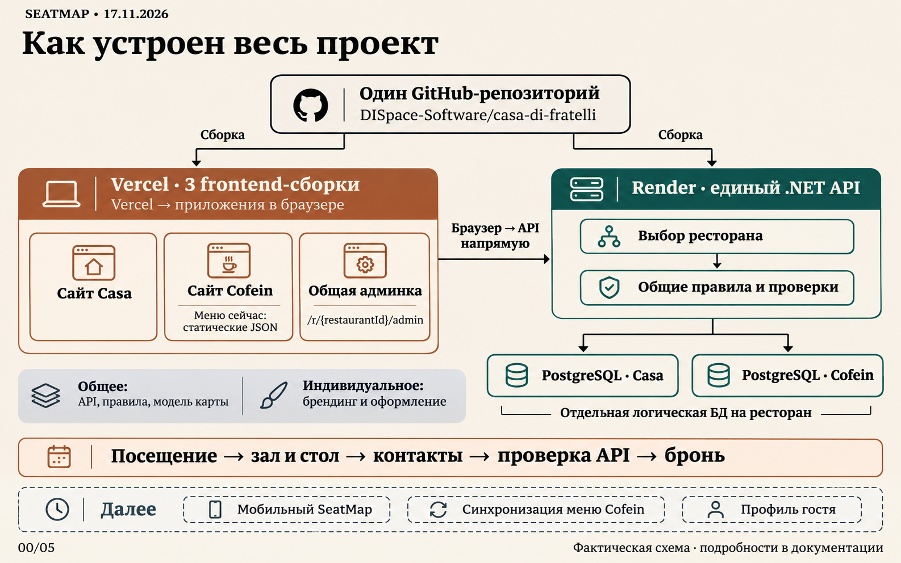
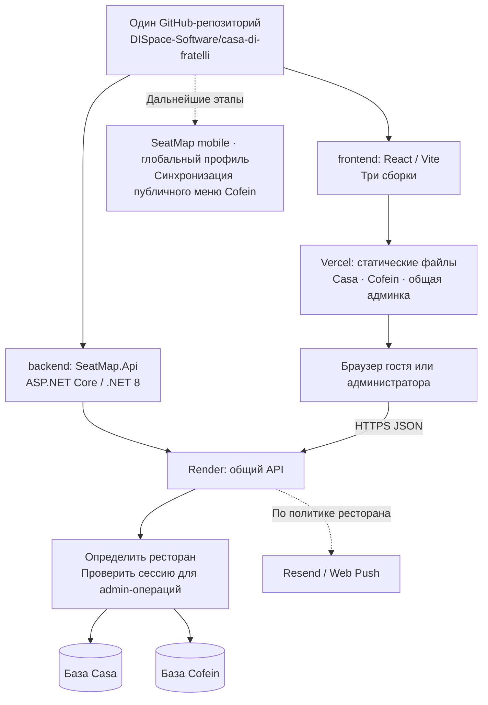

# 00. Как устроен весь проект

[Все схемы](README.md) · [Изображение в полном размере](images/00-overview.png)

**SeatMap — общая система для ресторанов.** Casa di Fratelli и Cofein имеют собственные публичные сайты. Администраторы пользуются одним приложением, которое определяет ресторан из адреса. Все три интерфейса обращаются к общему API, а тот выбирает базу конкретного ресторана.

Название GitHub-репозитория осталось историческим: `casa-di-fratelli`. Это не означает, что в нём только Casa. Отдельные приложения и проекты Vercel не являются отдельными репозиториями.

В браузере работают оформление, карта, выбор параметров и формы. На сервере проверяются доступность, права сотрудника, закрытия залов и правила столов. PostgreSQL хранит брони, CRM, план ресторана, меню и операционные данные.

**Важное исключение:** публичное меню Cofein пока читается из `menu-food.json` и `menu-drinks.json`, включённых в сборку сайта. Изменения меню в админке записываются в базу, но до публичного меню Cofein ещё не доходят.

Схема показывает общий состав продукта. Сборки frontend, API и базы имеют разные циклы публикации: один и тот же commit нельзя автоматически приписывать всем production-компонентам. [Границы подтверждённой версии](README.md#какая-версия-описана) зафиксированы отдельно.

Источники среза `243623e`: `frontend/package.json`, три frontend entrypoint, `backend/SeatMap.Api/Program.cs`, `Services/Tenancy`, `Data/AppDbContext.cs`, `frontend/src/cofein/CofeinMenu.jsx`.
