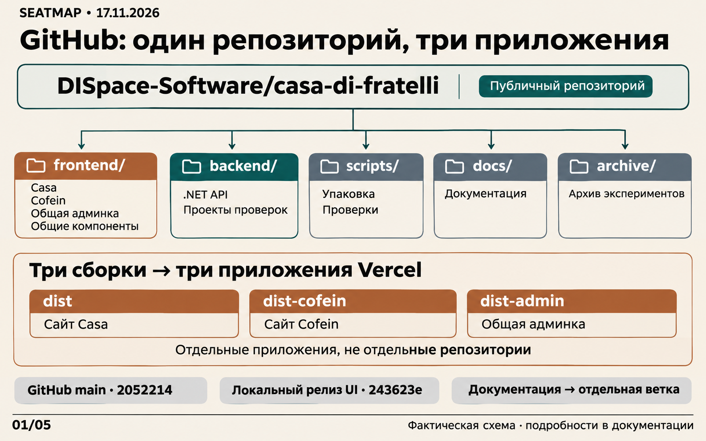
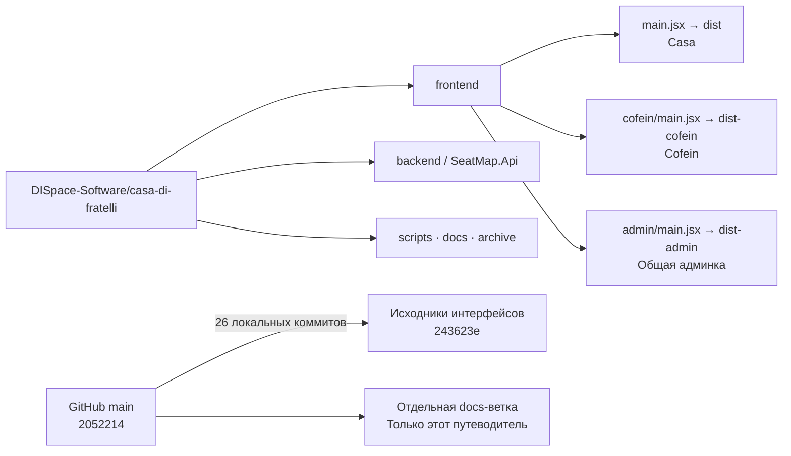

# 01. GitHub, приложения и папки

[Все схемы](README.md) · [Изображение в полном размере](images/01-github.png)



Подтверждён один относящийся к этому продукту репозиторий организации: **[DISpace-Software/casa-di-fratelli](https://github.com/DISpace-Software/casa-di-fratelli)**. Отдельные репозитории `cofein`, `seatmap-api` и `seatmap-admin` в проверенном списке не найдены. Эти имена используются для частей продукта и размещения.

```text
casa-di-fratelli/
├── frontend/
│   ├── src/main.jsx                 # публичный сайт Casa
│   ├── src/cofein/main.jsx          # публичный сайт Cofein
│   ├── src/admin/main.jsx           # общая админка
│   ├── src/components/              # общие UI и карты
│   ├── src/domain/                  # frontend-правила и геометрия
│   └── vite*.config.js              # отдельные точки сборки
├── backend/
│   └── SeatMap.Api/                 # общий API и модули
├── scripts/                        # упаковка и проверки
├── docs/                           # документация
└── archive/                        # отложенные эксперименты
```

Дерево относится к исходникам `243623e`, а не ко всем файлам старого `main`. В `backend` также находятся проекты проверок: это проверочные программы, а не отдельные backend-сервисы.



## Ветки на 17.11.2026

| Где | Ветка | Состояние |
| --- | --- | --- |
| GitHub | `main` | `2052214` |
| GitHub | `feat/shared-restaurant-admin-20261104` | `11acdc0` |
| GitHub | `fix/casa-admin-capacity-20261104` | `cb08322` |
| Локально | `feat/cofein-booking-ux-20261113` | `243623e`; из неё опубликованы свежие Cofein и общая админка |
| Документация | `docs/seatmap-visual-guide-20261117` | Отдельная ветка от `main`; не включает изменения приложения |

**Worktree** — дополнительная рабочая папка того же Git-репозитория. Она позволяет проверять отдельную ветку, сохраняя незакоммиченные изменения в другой папке. Это не новый репозиторий и не отдельное приложение.

Список веток и хешей — исторический снимок, который изменится после новых push/merge. Проверка выполнена по GitHub API через `gh` и локальным `git worktree`, `git log`, `git status`; подключённый список GitHub-репозиториев вернул пустой результат, поэтому использован CLI.
