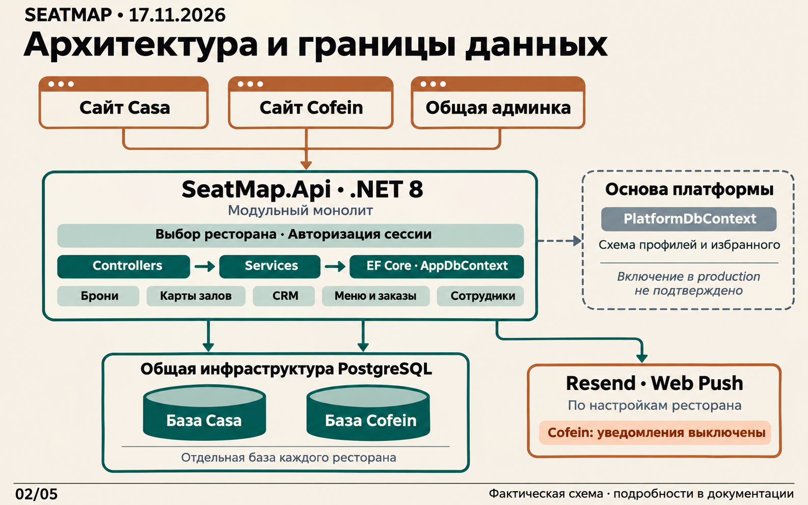
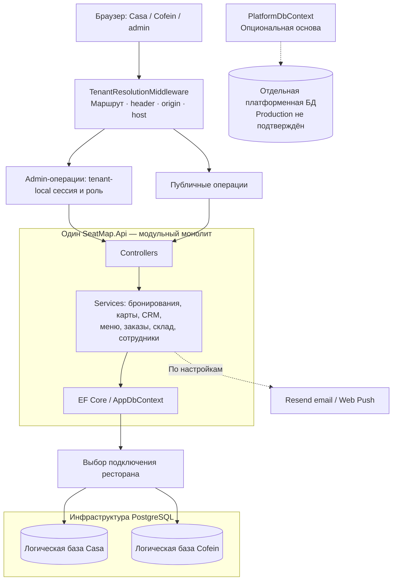

# 02. Архитектура и границы данных

[Все схемы](README.md) · [Изображение в полном размере](images/02-architecture.png)

Backend — **модульный монолит на .NET 8**: один процесс `SeatMap.Api`, внутри которого живут бронирования, планы залов, CRM, меню, заказы, склад, сотрудники, маркетинг и другие модули. В исходниках есть папки `Controllers`, `Services`, `Models`, `Dtos`, `Data`, `Migrations`, `Filters`, `Platform`. Отдельные проекты Domain/Application/Infrastructure ещё не выделены.

## Что определяет ресторан

Публичный клиент Cofein использует `/api/v1/restaurants/cofein/*`. Общая админка открывается по `/r/cofein/admin` либо `/r/casa-di-fratelli/admin`; её API-запросы передают `X-Tenant-Id`. Противоречивые указания ресторана отклоняются.

**Выбор ресторана и право доступа — разные проверки.** URL/header выбирает данные; административная сессия и роль разрешают действие. `/api/admin/login` создаёт tenant-local сессию, `/api/admin/me` её проверяет. Tenant-specific ключи браузерного хранилища помогают разделять клиентское состояние.

`AppDbContext` подключается к логической базе выбранного ресторана. При запуске конфигурация запрещает совпадение database-target у активных tenants. Отдельные базы не означают отдельные процессы API или два отдельных оплачиваемых PostgreSQL-сервера: Cofein был размещён в существующей инфраструктуре PostgreSQL.

## Ответственность слоёв

| Область | Что ей принадлежит |
| --- | --- |
| Frontend | Форма, навигация, стили, логотип, SVG-мебель, стены и камера карты; предварительные проверки для удобства |
| API | Авторизация, доступность, серверные лимиты, комбинации столов, сезонные закрытия, транзакции |
| База ресторана | Брони и связи со столами, CRM, меню, операции, сессии, настройки и версия плана |
| Фоновые задачи | Работа в отдельном tenant scope для каждого ресторана; уведомления, маркетинг и экспорт |
| Платформенный слой | Каталог из конфигурации; опциональные модели глобальных гостей, избранного и ссылок на брони |

`RestaurantWriteTransaction` координирует связанные изменения доступности и карты через транзакцию и PostgreSQL advisory lock. Это серверная защита от конкурирующих записей; визуально свободный стол в браузере сам по себе не гарантирует успешную бронь.

## Направление DDD

Следующее развитие — выделять чистые правила `VenueLayout`, `BookingPolicy`, `Reservation`, прикладные команды и инфраструктурные адаптеры внутри монолита. Сейчас, например, `FloorPlanService` совмещает проверки с EF. Эта схема описывает текущую реализацию; целевые DDD-границы не изображены готовыми микросервисами.

`PlatformDbContext` и миграции уже существуют, но гостевой вход, профиль, избранное, «Мои брони», мобильное приложение и доставка проекций бронирований ещё не составляют готовый пользовательский сценарий. Включение платформенной БД в production не проверено.

Источники `243623e`: `backend/SeatMap.Api/Program.cs`, `Services/Tenancy/*`, `Services/Reservations/RestaurantWriteTransaction.cs`, `Services/FloorPlans/FloorPlanService.cs`, `Data/AppDbContext.cs`, `Platform/Data/PlatformDbContext.cs`, `frontend/src/config/tenantRuntime.js`, `tenantApi.js`.
