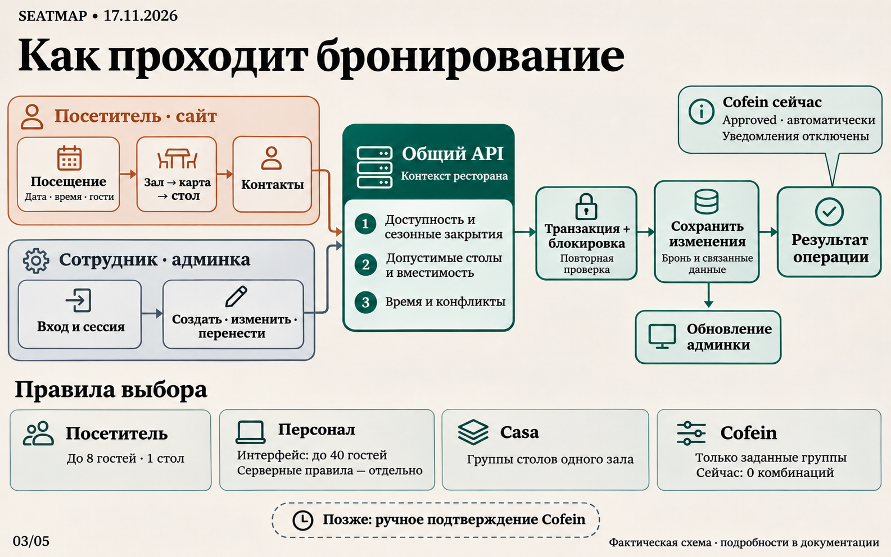
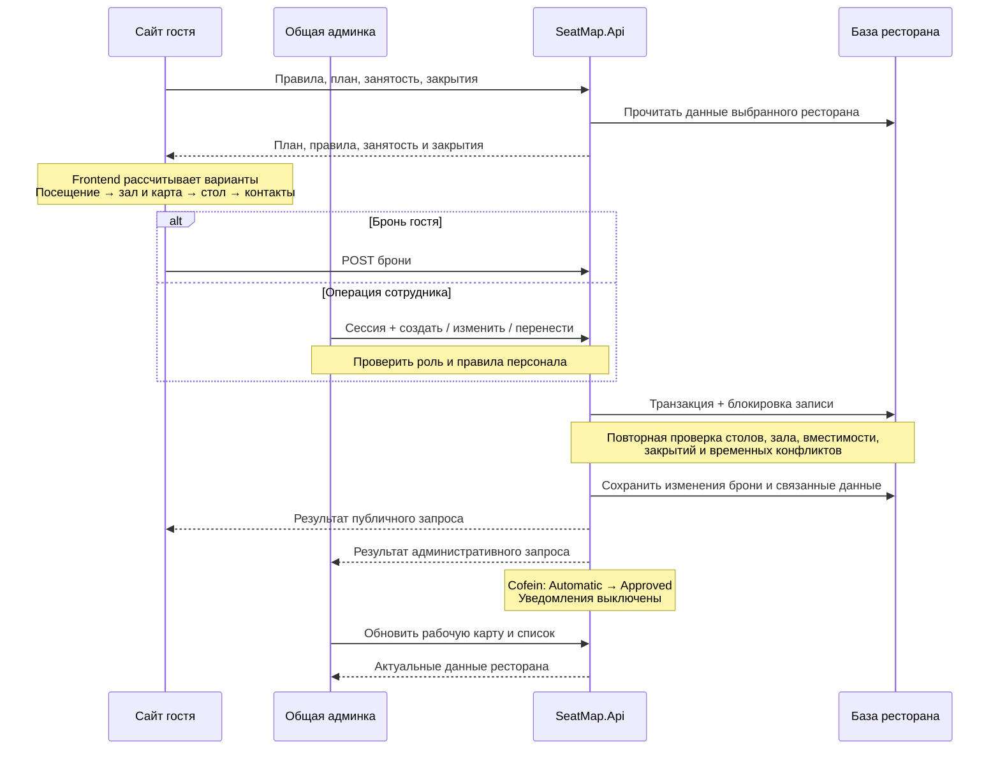

# 03. Как проходит бронирование

[Все схемы](README.md) · [Изображение в полном размере](images/03-reservation-flow.png)

Гость выбирает дату, время, количество людей и зал, затем стол на карте и контакты. Параметры посещения и карта находятся в одном рабочем пространстве; форма контактов открывается следующим шагом. Администратор может создавать, редактировать и переносить бронь из своей рабочей карты или списка.

Стрелки ответа в схеме относятся к соответствующему инициатору запроса. Сервер не рассылает ответ создания одновременно всем открытым клиентам: админка получает актуальные данные при обновлении. Обычный опрос видимой вкладки выполняется каждые 5 секунд и приостанавливается во время некоторых операций редактирования.

Frontend Cofein рассчитывает доступные варианты по полученному плану, правилам, занятости и закрытиям; API окончательно проверяет их при записи. Итоговая проверка выполняется внутри транзакции после получения блокировки. CRM обновляется при подтверждённом создании/подтверждении, а не при каждой операции: перенос меняет бронь, связи со столами и связанные обозначения столов в заказах.

## Проверенные правила на 17.11.2026

| Сценарий | Casa | Cofein |
| --- | --- | --- |
| Публичная бронь | Максимум 8 гостей и 1 стол; проверяется вместимость | Максимум 8 гостей и 1 стол; проверяется вместимость |
| Несколько столов для персонала | Активные столы одного зала (`same-zone`) | Только заданные группы (`configured`); сейчас комбинаций **0** |
| Количество людей для персонала | Можно превысить номинальную вместимость при разрешённой staff-операции | Такая же серверная возможность; правила выбора столов сохраняются |
| Поле гостей в админке | До 40 | До 40 |
| Подтверждение Cofein | — | Автоматическое; уведомления отключены |

**40 — ограничение интерфейса, а не единый серверный предел всех команд.** Обычные команды создания/изменения проверяют положительное число и staff override; walk-in дополнительно ограничивается 40. Не следует считать произвольное объединение столов Cofein работающей функцией, пока его конфигурация содержит ноль разрешённых комбинаций.

Перенос принимает новый набор разрешённых столов, число гостей, дату и время. API заново проверяет конфликт и правила; изменение в браузере не обходит сервер. Для проверки доступности используется временной буфер 180 минут.

Сезонное закрытие исключает столы закрытого зала из доступной вместимости. Счётчик свободных мест учитывает открытые активные залы, пришедших и опаздывающих; доступность конкретной брони отдельно определяется по столам и времени.

## Подтверждения и уведомления

В системе существует режим `EmailForFirstVisit`: новому email нужна ссылка подтверждения, а ранее подтверждённый клиент может получить `Approved` сразу. Это настраиваемый сценарий, а не обязательный шаг любой брони. После перехода по ссылке сервер повторяет проверку. Ожидающие email-подтверждения брони скрыты из обычного административного списка.

В Cofein сейчас действует `Automatic`; ручное подтверждение администратором остаётся отложенной задачей. Не путайте его с email-подтверждением гостя. Голосовой ввод также пока локальный прототип за условием `DEV && VITE_RESERVATION_VOICE_PREVIEW === "true"`.

Источники `243623e`: `frontend/src/cofein/bookingApi.js`, `CofeinBooking.jsx`, `frontend/src/pages/AdminPage.jsx`, `backend/SeatMap.Api/Services/Reservations/*`, `Controllers/ReservationsController.cs`, `Services/FloorPlans/FloorPlanService.cs`, `Services/SeasonalZoneService.cs`, `frontend/src/domain/adminMap/occupancy.js`. Числовая конфигурация — read-only ответы production API от 17.11.2026.
