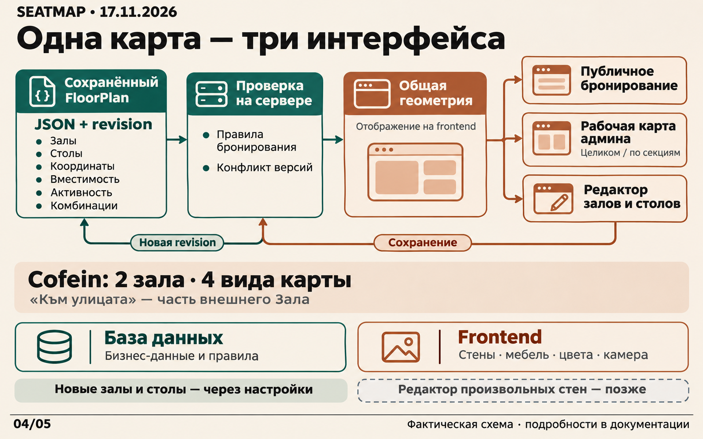
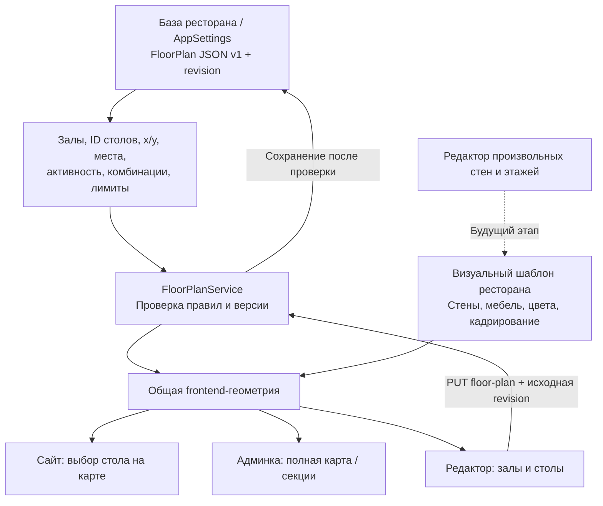

# 04. Одна карта для сайта, админки и редактора

[Все схемы](README.md) · [Изображение в полном размере](images/04-floor-plan.png)

У Cofein один сохранённый план и общая frontend-геометрия для публичного бронирования, рабочей карты администратора и редактора. Координаты стола и его вместимость не должны расходиться между этими интерфейсами.

## Два зала — четыре подробных вида

| Бизнес-зал в API | Подробный вид карты | Надпись для гостя |
| --- | --- | --- |
| `interior` | `interior-main` | Основна част |
| `interior` | `interior-angled` | Ъглова част |
| `exterior` | `exterior-upper` | Към градината |
| `exterior` | `exterior-lower` | Към улицата |

Четыре вида — вырезки камеры, а не четыре независимых зала. Переключение вида не меняет сезонное закрытие или правила бронирования. Участок со стороны улицы уже входит во внешний зал. Отдельная уличная/садовая посадка за исходным контуром здания без её столов и вместимости не добавлена автоматически.

В прочитанном плане Cofein — 2 зала и 30 столов; Casa — 3 зала и 51 стол. Эти числа являются настройкой конкретного плана и могут изменяться.

## Где хранится информация

| Сервер и БД | Frontend |
| --- | --- |
| Стабильные ID залов и столов, названия, координаты, вместимость, активность | SVG-стены, мебель, оттенки, визуальный шаблон ресторана |
| Разрешённые комбинации и публичные лимиты | Миниатюры, положение камеры, управление жестами |
| Версия плана и проверка сохранения | Черновик редактора и визуальное состояние выбора |
| Проверка существующих/будущих броней и истории ID | Предварительные подсказки и проверки формы |

Новые залы и столы задаются данными. Для дополнительных залов frontend строит новые области карты; исходное расположение Cofein сохраняется. До четырёх залов навигация использует кнопки, далее — список выбора. Это список **залов**: отдельный публичный список столов убран, гость выбирает стол на карте.

В текущем контракте есть защитные пределы: до 50 залов, 500 столов и 2000 заданных комбинаций; вместимость стола 1–500. Координаты 5–95 и минимальное расстояние между активными столами одного зала 6 единиц дополнительно ограничивают размещение. Поэтому «добавлять сколько угодно» не означает отсутствие серверных ограничений.

Редактор сохраняет план с исходной `revision`; при конфликте нельзя незаметно перезаписать более свежий план. ID связаны с историей бронирований, поэтому удаление и отключение проверяются сервером. Сезонное закрытие — самостоятельная операция.

**Оговорка для Casa:** её публичный клиент пока использует три предопределённые зоны, а админка сохраняет прежний редактор столов. Полный сценарий добавления залов включён для Cofein и других новых ресторанов; для Casa нужен отдельный перевод публичной страницы на полный контракт плана.

Источники `243623e`: `frontend/src/domain/floorPlans/cofeinGeometry.js`, `frontend/src/components/floorplan/*`, `backend/SeatMap.Api/Services/FloorPlans/FloorPlan.cs`, `FloorPlanService.cs`, `docs/restaurant-map-architecture.md`.
