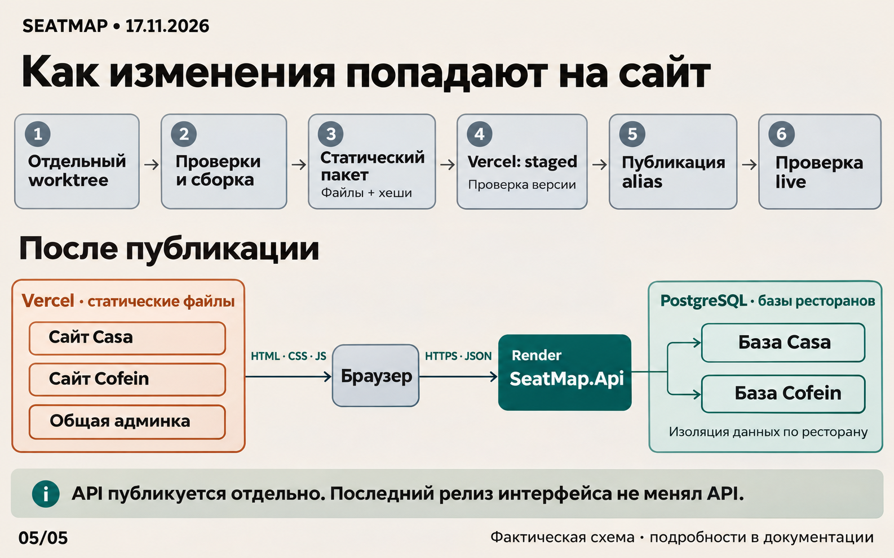
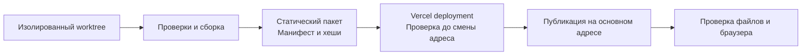
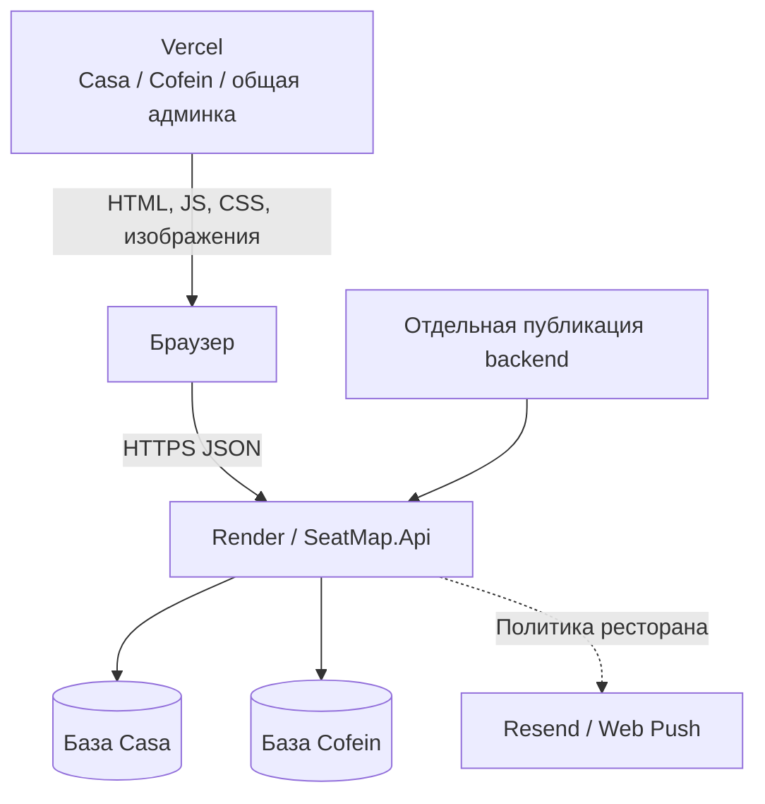

# 05. Сборка, размещение и публикация

[Все схемы](README.md) · [Изображение в полном размере](images/05-deployment.png)

Frontend размещается на Vercel как статические HTML/JS/CSS и ресурсы. Браузер загружает их и напрямую отправляет HTTPS JSON-запросы к API на Render. Статические проекты Vercel не являются отдельными backend-сервисами или API-прокси.

| Часть | Сборка / размещение | Адрес |
| --- | --- | --- |
| Casa | `npm run build` → `dist` → Vercel | [casadifratelli.bg](https://casadifratelli.bg) |
| Cofein | `npm run build:cofein` → `dist-cofein` → Vercel | [cofein.vercel.app](https://cofein.vercel.app) |
| Общая админка | `npm run build:admin` → `dist-admin` → Vercel | [Cofein admin](https://seatmap-admin-eight.vercel.app/r/cofein/admin), [Casa admin](https://seatmap-admin-eight.vercel.app/r/casa-di-fratelli/admin) |
| Общий API | .NET 8 / Docker → Render `seatmap-api` | [API](https://casa-di-fratelli-api.onrender.com) |
| Данные | PostgreSQL | Отдельная логическая база каждого ресторана; прямого доступа из браузера нет |

Команды frontend относятся к срезу `243623e` и выполняются из папки `frontend`. Наличие команды сборки не означает, что ветка GitHub автоматически публикуется: текущие релизы Cofein и админки выпускались отдельными статическими пакетами.

## Что проверяется при выпуске

1. Исходники и commit нужной рабочей папки; отсутствие случайных изменений в пакете.
2. Lint, сборки и проверки затронутой логики; браузерные сценарии нужного интерфейса.
3. Статический пакет с разрешёнными файлами, маршрутами админки и манифестом хешей.
4. Новое размещение до переключения основного адреса, затем опубликованные хеши и рабочие пользовательские сценарии.

Для shared admin есть отслеживаемый упаковщик `scripts/package-shared-admin.py`. Для текущего Cofein пакет и правила маршрутов сохранены в артефактах релиза; отдельный отслеживаемый упаковщик Cofein в проверенных исходниках не найден.

В релизе 17 ноября опубликованы Cofein и общая админка из `243623e`. Манифест фиксирует 29 успешных браузерных проверок админки и 4 успешные проверки публичной части с 9 контрольными состояниями, без обнаруженных browser audit issues. Эти числа обозначают проверки, а не количество устройств или ширин экрана; физическое тестирование всех моделей телефонов не заявляется.

**Render API при этом не переопубликовывался.** Последняя найденная локальная запись о backend-релизе относится к 6 ноября и `43ac1f6`; она историческая и не подтверждает текущий live commit Render. Версия сайта Casa также не установлена этим выпуском. Состояние production платформенной БД и долговременного хранилища экспортов не проверялось.

Источники: `frontend/package.json`, `vite.admin.config.js`, `vite.cofein.config.js`, `scripts/package-shared-admin.py`, документы размещения и сохранённые манифест/проверка целостности релиза 17.11.2026. Публичный индекс evidence приведён [здесь](evidence.json); секреты и внутренние идентификаторы облачных проектов не включены.
