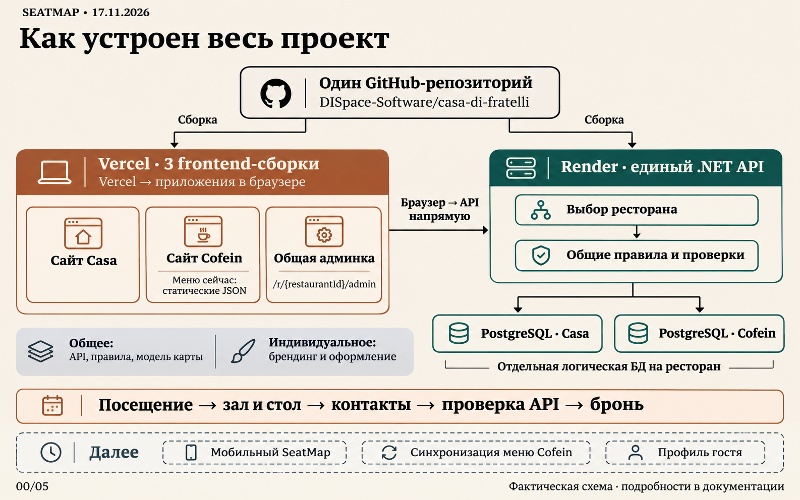

# SeatMap / Casa di Fratelli / Cofein — визуальный путеводитель

Срез на **17 ноября 2026 года**. Один репозиторий содержит сайты двух ресторанов, общую админку и общий API. Базы ресторанов разделены. Ниже — шесть отдельных изображений, пояснения и редактируемые схемы Mermaid.

| Схема | Что показывает |
| --- | --- |
| [00. Весь проект](00-overview.md) | Код, интерфейсы, сервер, данные и будущие части вместе |
| [01. GitHub и папки](01-github.md) | Единственный подтверждённый репозиторий, приложения и состояние веток |
| [02. Архитектура](02-architecture.md) | Реальные модули API, изоляция ресторанов и границы ответственности |
| [03. Бронирование](03-reservation-flow.md) | Путь гостя, операции администратора и серверная проверка |
| [04. Карта и залы](04-floor-plan.md) | Общий план для сайта, админки и редактора; два зала и четыре вида Cofein |
| [05. Публикация](05-deployment.md) | Сборка, Vercel, Render и проверка опубликованной версии |

## Как читать схемы

Сплошные блоки описывают реализованную структуру. Пунктир обозначает будущие или опциональные части; точный статус подписан рядом. Цвет помогает отличать интерфейсы от серверных компонентов и данных. Стрелка означает только указанную связь: сборка приложения и сетевой запрос — разные процессы.

Изображения созданы встроенным **image_gen** и проверены по исходникам. Это обзорные иллюстрации: точные ограничения и различия окружений приведены в тексте каждой страницы. Исходные задания сохранены в [prompts](prompts/README.md); схемы Mermaid находятся непосредственно под изображениями и доступны для редактирования.

## Какая версия описана

| Объект | Проверенное состояние |
| --- | --- |
| GitHub | Публичный [DISpace-Software/casa-di-fratelli](https://github.com/DISpace-Software/casa-di-fratelli); `main` на момент аудита — `20522145ef82a444a34ae7497228bf7ac4a7d977` |
| Исходники новых интерфейсов | `243623ef51c540063a87fcde235dbb2ef8559af5`, локальная ветка `feat/cofein-booking-ux-20261113`; 26 коммитов поверх указанного `main` |
| Cofein и общая админка | Релиз 17.11.2026 собран из `243623e`; соответствие опубликованных файлов сборке проверено по хешам |
| Сайт Casa | Отдельное действующее приложение; релиз Cofein и админки 17 ноября его не публиковал. Текущий commit сайта Casa в этом аудите не установлен |
| Render API | Общий работающий API. В релизе интерфейсов 17 ноября не переопубликовывался; его текущий production commit отдельно не подтверждён |
| Правила ресторанов | Настройки плана и контекста прочитаны из API 17.11.2026 без изменения данных |

**Этот пакет документации опубликован отдельной веткой от `main`.** Он описывает также более свежие опубликованные интерфейсы. Пути исходников в пояснениях относятся к срезу `243623e`: некоторые файлы ещё отсутствуют в старом `main`. Добавление этой документации само по себе не переносит 26 коммитов приложения и не развёртывает сайт.

## Что уже есть, а что остаётся сделать

| Возможность | Статус на дату среза |
| --- | --- |
| Сайты Casa и Cofein, общая админка | Работают; оформление выбирается для ресторана |
| Изоляция ресторанов | Отдельные логические PostgreSQL-базы; общий процесс API |
| План Cofein на сайте и в админке | Общие данные и геометрия; в админке есть полная карта и секции |
| Ручное подтверждение броней Cofein | Отложено. Сейчас автоматическое подтверждение; уведомления выключены |
| Объединение столов персоналом Cofein | Поддерживаются заданные комбинации, но в прочитанном плане комбинаций **0** |
| Публичное меню Cofein из админки | Ещё не подключено: сайт импортирует JSON-файлы, админка меняет меню в БД |
| Голосовой ввод резервации | Локальный прототип за DEV-флагом; не production-функция |
| Платформенная БД | Модель и миграции существуют; включение в production этим аудитом не подтверждено |
| SeatMap mobile, глобальный профиль, избранное и «Мои брони» | План развития; готового пользовательского сценария нет |
| Полное выделение DDD-слоёв и редактор произвольных стен | План развития |

## Обновление документации

При изменении структуры сначала обновляйте текст и Mermaid соответствующей страницы, затем изображение и задание в `prompts`. Для нового релиза сверяйте исходники, GitHub и фактическое окружение отдельно. Числа столов, лимиты и режимы подтверждения — настройки на дату среза, а не неизменные свойства системы.

Перечень проверенных источников: [evidence.json](evidence.json). Исторические документы в соседней папке сохраняют контекст своих дат; новый путеводитель уточняет состояние на 17 ноября и не превращает старые планы в реализованные функции.
